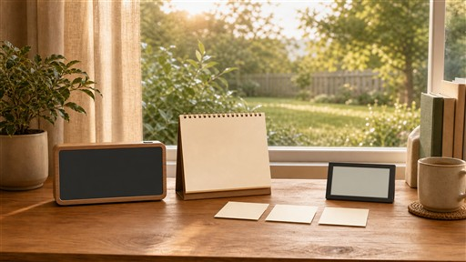

# MorningDesk · 清晨书桌

一块给 Wallpaper Engine 用的动态桌面壁纸：清晨书桌的实景里嵌着时钟、台历、CPU / GPU / 内存便签，以及一块天气 + 网速屏。所有数字都是真实的 —— 来自你这台电脑。



项目由两部分组成：

| 部分 | 说明 |
|---|---|
| **前端壁纸** | 纯 HTML / CSS / JavaScript，作为 Wallpaper Engine 的「网页」壁纸运行，已发布到 Steam 创意工坊 |
| **本机后台** | `MorningDeskBackend.exe`，读取 CPU / GPU / 内存 / 磁盘 / 网络 / 天气，通过 `http://127.0.0.1:43761` 提供给壁纸；登录自动启动，全程无窗口 |

之所以拆成两部分：**Steam 创意工坊不接受 exe**，所以壁纸本身只包含网页，后台单独在 GitHub 发布。

---

## 给使用者

### 第 1 步：订阅壁纸

在 Wallpaper Engine 的创意工坊里订阅 **MorningDesk 清晨书桌**：

> <https://steamcommunity.com/sharedfiles/filedetails/?id=3825200540>

> **状态：审核中。** 截至 2026-10-23，该创意工坊条目仍在 Steam 审核，通过前链接可能无法打开或搜索不到。审核通过后即可正常订阅；在那之前可以先按 [docs/WORKSHOP.md](docs/WORKSHOP.md) 把工程加载到本地预览。

### 第 2 步：下载后台

在本仓库的 **Releases** 页面，或 [`release/`](release/) 目录，下载：

```
MorningDeskBackend-1.0.0.zip
```

### 第 3 步：安装

1. 把 zip 解压到任意位置（解压后能直接删，安装完就不需要它了）。
2. 双击 `Install.cmd`。
3. Windows 会弹出一次「是否允许此应用对你的设备进行更改」——点「是」。读取 CPU 温度需要管理员权限，只需要这一次。
4. 看到 `Done` 就好了。

安装完成后：

- 后台立即开始工作，以后每次登录 Windows 都会自动启动；
- **不会出现任何窗口、黑框或 UAC 提示**；
- 开始菜单里会出现 `MorningDesk` 文件夹：重启后台 / 接口状态 / 打开日志 / 卸载；
- 回到 Wallpaper Engine，选中壁纸即可。

> 如果双击 `Install.cmd` 没反应，可以右键它 →「以管理员身份运行」。

### 系统要求

- Windows 10 / 11，64 位
- Wallpaper Engine（Steam）
- 不需要安装 Node.js，也不需要额外安装 .NET 运行时

### 更新 / 卸载

- **更新**：下载新版本 zip，重新双击 `Install.cmd` 覆盖安装即可（会先停掉旧后台）。
- **卸载**：开始菜单 `MorningDesk → 卸载`，或运行安装目录里的 `uninstall.ps1`。
- **安装位置**：`%LOCALAPPDATA%\MorningDesk`
- **日志**：`%LOCALAPPDATA%\MorningDesk\logs\backend.log`
- **接口自检**：<http://127.0.0.1:43761/api/health>

### 常见问题

| 现象 | 处理 |
|---|---|
| 壁纸上的数字全是 `--` | 后台没在跑。开始菜单 `MorningDesk → 重启后台`，再点「接口状态」确认 |
| 天气一直显示「IP 定位中」 | 首次定位或网络未就绪，等 1 分钟；仍不行就看日志 |
| CPU 温度显示 `N/A` | 传感器驱动未加载或权限不足；GPU 温度、内存、网速、天气不受影响 |
| 地名不对 | 按公网 IP 定位，开代理 / VPN 会定位到出口所在地；关掉后重启后台 |
| 端口 43761 被占用 | 见 [docs/CUSTOMIZE.md](docs/CUSTOMIZE.md) 的「换端口」 |
| 安装后壁纸没变化 | 在 Wallpaper Engine 里重新选中一次壁纸，或重启 Wallpaper Engine |

更多排查：[docs/TROUBLESHOOTING.md](docs/TROUBLESHOOTING.md)

---

## 给开发者 / 想改造的人

```powershell
npm install
npm run build:backend    # 后端单文件 -> dist/build/payload/MorningDeskBackend.exe
npm run build:service    # 后端 + 静默守护器 -> dist/service
npm run build:web        # 生成/更新 Wallpaper Engine 网页壁纸工程
npm run install:service  # 本机安装（开发用，一次 UAC）
```

文档：

- [docs/ARCHITECTURE.md](docs/ARCHITECTURE.md) —— 架构、数据流、API 契约
- [docs/BUILD.md](docs/BUILD.md) —— 构建、打包、发版
- [docs/CUSTOMIZE.md](docs/CUSTOMIZE.md) —— 换背景、调布局、校准、换端口、加指标
- [docs/WORKSHOP.md](docs/WORKSHOP.md) —— 创意工坊上传说明
- [docs/TROUBLESHOOTING.md](docs/TROUBLESHOOTING.md) —— 排错
- [AGENTS.md](AGENTS.md) —— 给 AI 编码助手的入口说明

### 目录结构

```
public/       前端页面（lifestyle.* 是清晨书桌版；index.* 是旧的技术仪表盘版）
server/       Node 后端：硬件采集、天气、HTTP / SSE
desktop/      C# 宿主：BackendHost.cs 是静默守护器；其余是已弃用的窗口宿主
scripts/      构建、安装、打包脚本
packaging/    发布给普通用户的独立安装器（zip 里的内容）
tools/        LibreHardwareMonitorLib.dll（CPU 温度）
release/      构建好的后台压缩包与校验和
docs/         文档与预览图
```

### 设计要点

- **前端零构建**：WE 以 `file://` 加载页面，页面直接 `fetch` 回环地址，靠后端返回的 CORS 头工作。
- **后端单文件**：Node SEA 打包，用户不用装 Node；资源内嵌，启动时解压到临时目录。
- **静默**：计划任务调用 GUI 子系统的 `MorningDeskBackendHost.exe`，由它用 `CreateNoWindow` 拉起后端，并负责崩溃重启。
- **只监听回环**：`127.0.0.1:43761`，不对局域网开放。

---

## 为什么创意工坊版不带 exe

Steam 创意工坊对「应用程序」类内容审核严格，带 exe 的壁纸基本无法通过。因此：

- 创意工坊只发布网页壁纸（`project.json` 里 `"type": "web"`）；
- 后台程序通过 GitHub 发布，用户手动安装一次；
- 两边通过固定端口 `43761` 解耦，互不依赖。

## 许可

- 本项目代码：[MIT](LICENSE)
- 第三方组件与数据来源：[THIRD_PARTY_NOTICES.md](THIRD_PARTY_NOTICES.md)
